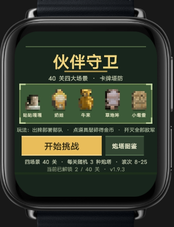
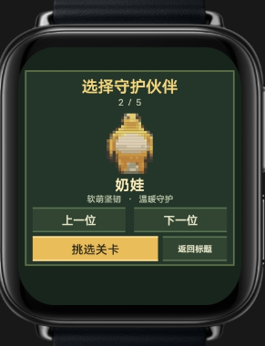
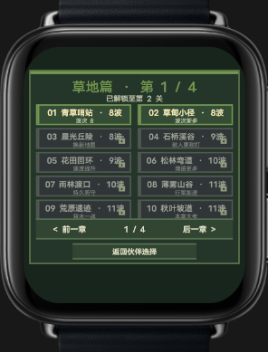
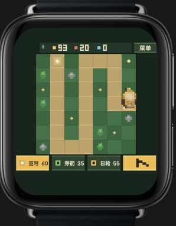

# 伙伴守卫

一款适配 vivo BlueOS 智能手表的像素塔防游戏。选择守护伙伴与关卡，在网格战场中布置防线，抵御来袭的敌人。

## 游戏截图

| 标题页 | 选择伙伴 | 选择关卡 | 战斗中 |
| --- | --- | --- | --- |
|  |  |  |  |

## 下载与安装

下载本仓库中的 RPK 文件，并在支持 vivo BlueOS 快应用的手机或手表环境中安装：

[下载伙伴守卫 RPK](./com.sci.radishguard.debug.production.1.0.0.rpk)

- 应用包名：`com.sci.radishguard`
- 包版本：`1.0.0`（versionCode `100`，来自 RPK 清单）
- 适配设备：圆屏与方屏手表
- 包类型：调试签名 RPK
- 最低平台版本：`1070`

> 说明：标题页截图中的游戏内版本标记为 `v1.9.3`，与 RPK 清单版本 `1.0.0` 不同。